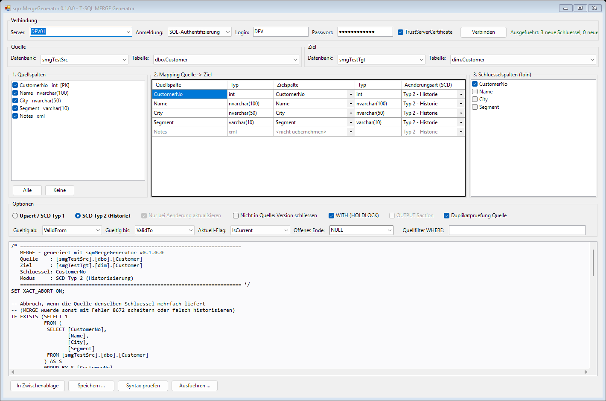

# sqmMergeGenerator

Part of the [powershelldba.de](https://www.powershelldba.de) SQL Server toolset by [Uwe Janke](https://www.powershelldba.de).

PowerShell module with a WinForms GUI that writes T-SQL `MERGE` statements for you: pick a
server, a source and a target table, map the columns (similar to the SSIS column mapping
editor), tick the join keys, and the statement is regenerated instantly on every change.
Supports a plain upsert (SCD type 1) and **slowly changing dimensions type 2** with a change
type per column.

No dbatools or other module dependency: it talks to SQL Server through `System.Data.SqlClient`,
so it runs on locked-down servers without PSGallery access. Works in Windows PowerShell 5.1
and PowerShell 7.



## GUI workflow

```powershell
Show-sqmMergeGeneratorGui                      # or: Start-sqmMergeGenerator.cmd
Show-sqmMergeGeneratorGui -SqlInstance SQL01   # connect right away
```

1. **Connection**: server, Windows or SQL authentication, TrustServerCertificate. The last
   servers and the login name (never the password) are remembered in
   `%APPDATA%\sqmMergeGenerator\config.json`.
2. **Source / target**: database and table per combo box. Views are offered as a source.
3. Three columns side by side:
   - **1. Source columns**: tick the columns to use.
   - **2. Mapping source -> target**: target column per source column (auto-mapped by name,
     case-insensitive), data types of both sides, change type per column.
     Computed, rowversion and `GENERATED ALWAYS` columns are never offered as a target.
   - **3. Key columns (join)**: preselected from the target primary key. If the target PK is not
     mapped (typical SCD 2 dimension with a surrogate key), the source PK is used instead.
4. **Options** (below), the generated statement at the bottom, with buttons to copy, save as
   `.sql`, check syntax (compiles with `SET NOEXEC ON`, resolves table and column names, runs
   nothing) and execute (with confirmation).

If the target table has a `ValidTo`/`IsCurrent`-style column (several German and English naming
patterns are recognised), the GUI switches to SCD type 2 mode and preselects those columns.

## Modes and options

| Option | Upsert / SCD 1 | SCD type 2 |
|---|---|---|
| Update only on real change | `WHEN MATCHED AND EXISTS (SELECT S.. EXCEPT SELECT T..)`, NULL-safe | always |
| Not in source | `WHEN NOT MATCHED BY SOURCE THEN DELETE` | close the current version |
| `WITH (HOLDLOCK)` | yes | yes |
| `OUTPUT $action` | key + action per row | summary row instead |
| Duplicate key check | `THROW 50001` before the MERGE if the source delivers a key twice | same |
| Source filter | `WHERE` inside the `USING` subquery | same |

Change type per column:

| Change type | Upsert / SCD 1 | SCD type 2 |
|---|---|---|
| Type 2 - history | overwrite | change closes the current version and inserts a new one |
| Type 1 - overwrite | overwrite | overwritten in **all** versions of the key, no new version |
| Fixed | never updated, only set on insert | same |

SCD type 2 needs a current flag column and/or a valid-to column; valid-from is optional. The
open end of a version is `NULL` or a fixed date such as `'9999-12-31'`.

Further details:

- `xml`, `text`, `ntext`, `image` and CLR types (`geography`, `geometry`, `hierarchyid`) are
  cast for the change comparison, since `EXCEPT` can't compare them directly.
- Mapping a target identity column in upsert mode wraps the statement in
  `SET IDENTITY_INSERT ... ON/OFF` and leaves the column out of `UPDATE SET`. In SCD 2 mode
  identity columns are rejected (the surrogate key is assigned by the table).
- The SCD 2 statement uses `MERGE ... OUTPUT INTO #smgMergeOutput` followed by a regular
  `INSERT`, not composable DML (`INSERT ... SELECT FROM (MERGE ...)`). That means it also
  works when the dimension has triggers or is referenced by foreign keys from fact tables.
  It runs in one transaction with `XACT_ABORT ON` and returns one row:
  `NeueSchluessel, NeueVersionen, GeschlosseneSchluessel, Typ1Aktualisiert`.
- All object names are fully qualified with three-part names, so source and target can be in
  different databases on the same instance.

## Scripting without the GUI

```powershell
# Upsert, mapping as hashtable source = target
New-sqmMergeStatement -SourceDatabase Staging -SourceTable Customer `
    -TargetDatabase DWH -TargetTable Customer `
    -ColumnMapping @{ CustomerNo = 'CustomerNo'; Name = 'Name'; City = 'City' } `
    -KeyColumns CustomerNo -DeleteNotMatchedBySource -HoldLock

# SCD type 2 with a change type per column
$map = @(
    @{ SourceColumn = 'CustomerNo'; TargetColumn = 'CustomerNo' }
    @{ SourceColumn = 'Name';       TargetColumn = 'Name';    ChangeType = 'Type1' }
    @{ SourceColumn = 'City';       TargetColumn = 'City';    ChangeType = 'Type2' }
    @{ SourceColumn = 'Segment';    TargetColumn = 'Segment'; ChangeType = 'Fixed' }
)
New-sqmMergeStatement -SourceDatabase Staging -SourceTable Customer `
    -TargetDatabase DWH -TargetSchema dim -TargetTable Customer `
    -ColumnMapping $map -KeyColumns CustomerNo -Mode Scd2 -DeleteNotMatchedBySource `
    -ValidFromColumn ValidFrom -ValidToColumn ValidTo -CurrentFlagColumn IsCurrent
```

Metadata helpers: `Get-sqmMergeDatabase`, `Get-sqmMergeTable`, `Get-sqmMergeColumn`.

## Installation

```
Install.cmd               # AllUsers when elevated, otherwise CurrentUser
Install.cmd CurrentUser
```

Or run it in place without installing: `Start-sqmMergeGenerator.cmd`.

## Tests

`Tests\Test-sqmMergeGenerator.ps1` creates two throwaway databases on a real instance, executes
the generated statements and checks the results (upsert with delete, idempotent re-run, xml
change detection, identity insert, SCD 2 with type 1/type 2/fixed columns, closing missing keys,
returning keys, trigger and foreign key on the dimension, duplicate key check). It drops the
databases afterwards.

```powershell
.\Tests\Test-sqmMergeGenerator.ps1 -SqlInstance DEV01 -SqlCredential (Get-Credential)
```

## License

MIT, see [LICENSE](LICENSE).
